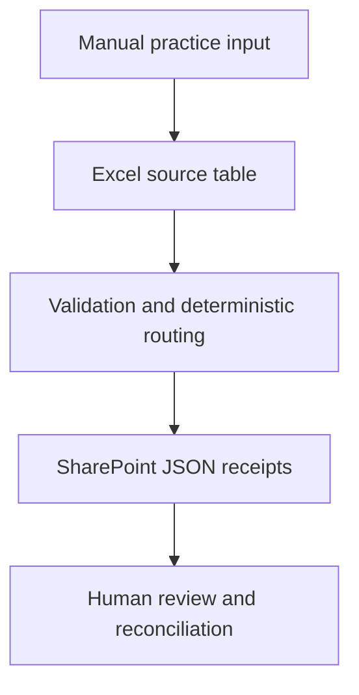

# Architecture

Separate request intake from certifier responses, apply a server tool gate and department recertification rules, and reconcile approved records with Power Query.

Operations uses December 31 of the submission year; Analytics uses submission date plus twelve months. These are explicit demo assumptions. W001 and M001 were the two approved rows in the native Power Query preview. The exported query template is evidence of a tested preview, not a deployed semantic model.

The manual input schema and complete action graph are in `flow/`. Only standard SharePoint and Excel actions carry out service operations. There are no HTTP or email-send actions. Conditions and loop operations use Power Automate expressions.

Intake and certifier responses are separate records. Certification joins on RequestId + Revision, suppresses stale revisions, and flags duplicate or ambiguous records. A one-account practice environment does not prove that reviewers and submitters have separate permissions. A production solution needs explicit access design, ownership, retention, error handling and a transaction-safe uniqueness strategy.

The current import preserves the seed connection configuration as invoker connections: the runner supplies authorized SharePoint/Excel connections. Do not broaden access to make a demo run.
