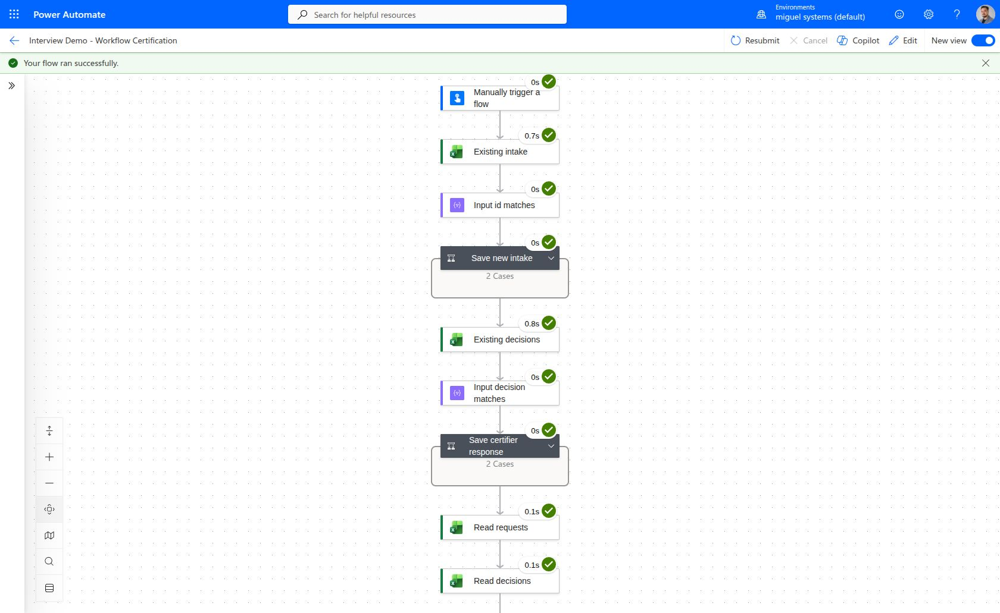
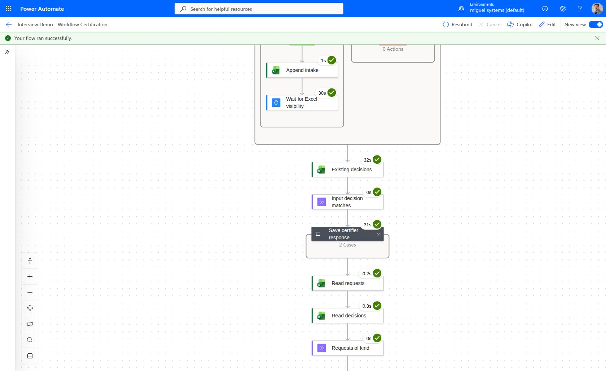

# Validation record

Test date: November 17, 2026, America/Chicago (November 18 UTC). Synthetic private tenant practice.

- Native package import: successful.
- Baseline flow run: **Succeeded**.
- Run identifier: `08584066440336070898876187423CU02`.
- Real emails: **0**.
- Native output reconciliation: see `validation/baseline/`, `expected-baseline.json`, and `python3 scripts/verify_receipts.py`.
- Further intake/replay checks: pending final evidence update.

Actual Power Automate run trace, captured after the service reported success. File values are independently reconciled because successful execution alone does not prove correct business outcomes.

Operations uses December 31 of the submission year; Analytics uses submission date plus twelve months. These are explicit demo assumptions. W001 and M001 were the two approved rows in the native Power Query preview. The exported query template is evidence of a tested preview, not a deployed semantic model.

Local reference simulation separately passed 17 checks across the original suite. That result is not the native Microsoft run result. Native screenshots and JSON previews are separate evidence. The sanitized portable configuration has not been tested in a second tenant.

## Native manual-form intake

W007 was added through the native trigger form; a separate certifier response was appended to decisions.xlsx. The result was Approved with recertification 2026-12-31. Captured receipt: `validation/intake/`.

